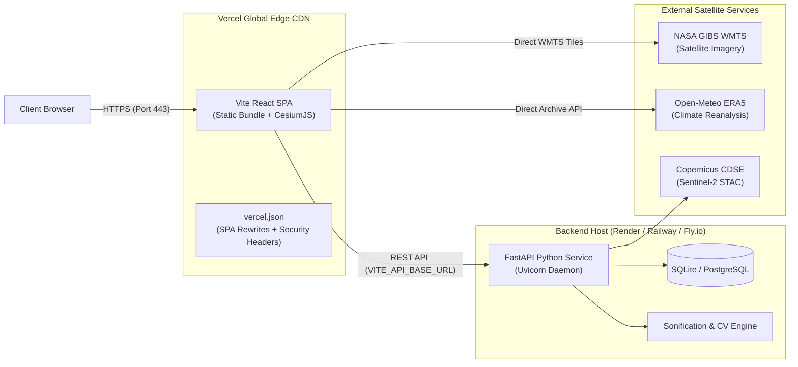

# Production Deployment Checklist — Earth Information Jukebox

**NASA Space Apps Challenge 2026**  
**Target Architecture:** Vercel (Frontend SPA) + Render / Railway / Fly.io / AWS (FastAPI Backend) + GitHub (Version Control)

---

## 1. Architecture Overview for Deployment



> [!IMPORTANT]
> **Why Frontend and Backend Are Hosted Separately:**  
> The frontend is a static React Single Page Application (SPA) utilizing CesiumJS, Vite, and Web Audio API — perfectly optimized for Vercel's global CDN. The backend is a persistent Python 3.12 service running FastAPI, OpenCV, Pillow, and SQLite/PostgreSQL, which requires a persistent Python runtime container (such as **Render**, **Railway**, **Fly.io**, or **AWS Lightsail/ECS**). Do not attempt to run persistent Uvicorn/OpenCV servers as serverless functions on Vercel without containerization.

---

## 2. GitHub Preparation Checklist

- [ ] **Verify `.gitignore` is Active:**
  Ensure `.env`, `*.db`, `backend/uploads/`, and `awesome-satellite-imagery-datasets/` are excluded.
  ```bash
  git status
  # Verify that .env and earth_jukebox.db do NOT appear in the untracked files list
  ```
- [ ] **Initialize Git & Make Initial Commit:**
  ```bash
  git add .
  git commit -m "feat: complete production-ready Earth Information Jukebox platform"
  ```
- [ ] **Create GitHub Remote Repository:**
  ```bash
  git remote add origin https://github.com/<your-username>/earth-information-jukebox.git
  git branch -M main
  git push -u origin main
  ```
- [ ] **Configure GitHub Repository Secrets (if using GitHub Actions CI/CD):**
  - Navigate to **Settings > Secrets and variables > Actions**.
  - Add any necessary deployment tokens (e.g. `VERCEL_TOKEN`, `RENDER_DEPLOY_HOOK`).
- [ ] **Enable GitHub Dependabot & Secret Scanning:**
  - In **Settings > Code security and analysis**, enable **Secret scanning** and **Dependabot alerts**.

---

## 3. Backend Deployment (Render / Railway / Fly.io)

### Recommended: Deploying to Render (Free/Standard Web Service)
1. **Create Web Service:**
   - Link your GitHub repository.
   - **Root Directory:** `backend`
   - **Environment:** `Python 3`
   - **Build Command:** `pip install --upgrade pip && pip install -r requirements.txt`
   - **Start Command:** `uvicorn app.main:app --host 0.0.0.0 --port $PORT`
2. **Configure Backend Environment Variables:**
   | Variable | Recommended Production Value | Description |
   | :--- | :--- | :--- |
   | `ENVIRONMENT` | `production` | Enables production security guards |
   | `DEBUG` | `false` | Disables verbose debug stack traces |
   | `CORS_ORIGINS` | `https://your-project.vercel.app` | **Critical:** Must match your Vercel frontend URL |
   | `JWT_SECRET` | *(64-character random hex string)* | Generate with `python -c "import secrets; print(secrets.token_hex(32))"` |
   | `JWT_ALGORITHM` | `HS256` | Token signature algorithm |
   | `NASA_API_KEY` | *(Your NASA API Key)* | Free key from [api.nasa.gov](https://api.nasa.gov) |
   | `RATE_LIMIT_DEFAULT_PER_MINUTE` | `120` | General rate limit |
   | `RATE_LIMIT_AUTH_PER_MINUTE` | `15` | Brute force defense limit |
   | `RATE_LIMIT_COMPUTE_PER_MINUTE` | `30` | Image processing limit |
   | `MAX_REQUEST_BODY_SIZE_BYTES` | `16777216` | 16 MB max file upload |
3. **Verify Health Endpoint:**
   Once deployed, test: `https://<your-backend-subdomain>.onrender.com/health` (should return HTTP 200 OK).

---

## 4. Frontend Deployment (Vercel)

### Step 1: Import Project into Vercel
1. Log in to [vercel.com](https://vercel.com) and click **Add New > Project**.
2. Select your `earth-information-jukebox` GitHub repository.
3. **Framework Preset:** Vite
4. **Root Directory:** Either leave as `./` (the root `vercel.json` will build `frontend`), OR set to `frontend`. Both are pre-configured with `vercel.json`!
5. **Build Command:** `npm run build`
6. **Output Directory:** `dist`

### Step 2: Configure Vercel Environment Variables
In the Vercel Project Settings under **Environment Variables**, add:

| Variable | Target Environments | Production Value | Description |
| :--- | :--- | :--- | :--- |
| `VITE_API_BASE_URL` | Production & Preview | `https://<your-backend-host>/api/v1` | Public URL of your deployed FastAPI service |

> [!TIP]
> Do NOT set private database passwords or JWT secrets in Vercel environment variables. The frontend bundle only requires `VITE_API_BASE_URL`.

### Step 3: Deploy & Verify
Click **Deploy**. Vercel will:
1. Run `npm install` and `npm run build`.
2. Generate optimized static chunks with CesiumJS code-splitting.
3. Deploy to global edge nodes with automated HTTPS and SSL certificates.
4. Enforce security headers and SPA routing rewrites from `vercel.json`.

---

## 5. Post-Deployment Verification Smoke Tests

Run these tests against the live production URLs:

1. **Frontend Landing & Navigation:**
   - [ ] Visit `https://<your-vercel-domain>.vercel.app/` — verify Home page hero renders with the 3D Cesium Earth globe.
   - [ ] Navigate to `/explore`, `/studio`, `/climate`, `/observatory`, and `/accessibility`.
   - [ ] **SPA Route Refresh Test:** While on `https://<your-vercel-domain>.vercel.app/#explore`, press **F5 (Hard Refresh)**. Confirm the page loads cleanly without a 404 error.
2. **Backend API Connectivity:**
   - [ ] Check `https://<your-backend-host>/health` — verify `status: "healthy"`.
   - [ ] In production, check `https://<your-backend-host>/docs` — verify that Swagger docs are disabled (HTTP 404) for production security.
3. **CORS Validation:**
   - [ ] Open the browser developer console (F12) on your Vercel site.
   - [ ] Perform an action that calls the backend (e.g. log in, save exploration, or upload an image).
   - [ ] Confirm no CORS errors appear in the browser console.
4. **3D Earth Globe Functionality:**
   - [ ] Verify CesiumJS Sentinel-2 imagery streams smoothly.
   - [ ] Click a geographic preset (e.g. Sahara, Amazon, Arctic) — verify camera animation.
   - [ ] Verify blue dots remain anchored to their coordinates and occlude behind the horizon.
5. **Earth Sonification:**
   - [ ] Start audio playback on Earth Explorer or Sound Studio — verify Web Audio synthesizes audio without browser errors.
