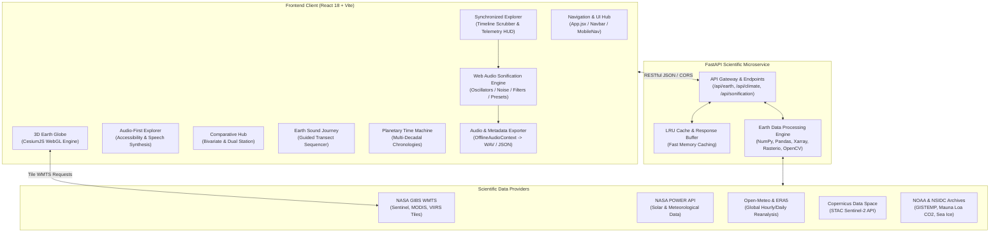
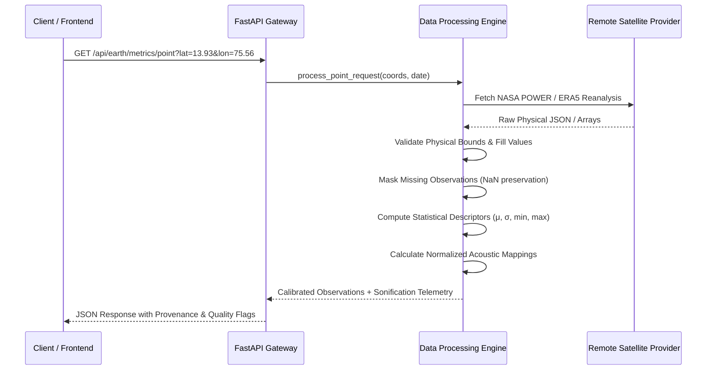

# Earth Information Jukebox — System Architecture Specification

## 1. Executive System Architecture

The **Earth Information Jukebox** is a multimodal scientific exploration platform developed for the NASA Space Apps Challenge. It combines real-time 3D planetary rendering (CesiumJS WebGL), multi-source satellite Earth observation telemetry, calibrated scientific data transformation (NumPy, Pandas, Xarray, Rasterio), Web Audio API parametric sound synthesis, and WCAG 2.2 AAA / Section 508 audio-first accessibility.



---

## 2. Frontend Layer Architecture

### 2.1 Technology Stack
- **Framework**: React 18.2 with Functional Components and Custom Hooks.
- **Build System**: Vite 8.3 with Rolldown/ESBuild bundler and code-splitting.
- **3D Geospatial Engine**: CesiumJS (WebGL Earth globe with progressive tile streaming and atmosphere physics).
- **Styling & UI**: Tailwind CSS, Lucide React Icons, Glassmorphism design system.
- **Motion & Transitions**: Framer Motion for hardware-accelerated animations.
- **Audio Synthesis**: Native Web Audio API (`AudioContext`, `OscillatorNode`, `BiquadFilterNode`, `StereoPannerNode`, `DynamicsCompressorNode`, `WaveShaperNode`) with Tone.js polyphonic scheduling.
- **Speech Synthesis**: W3C Web Speech API (`speechSynthesis` / `SpeechSynthesisUtterance`) for voice guidance.

### 2.2 Component Hierarchy & Routing
The frontend employs a unified, hash-based router (`window.location.hash`) coupled with URL query parameter serialization for 1-click exploration reproducibility:

```
App.jsx (Root Controller, Accessibility Provider, Keyboard Listener)
├── Navbar.jsx (Aerospace Top Bar, Preset Selector, High-Contrast & Guided Toggles)
├── GuidedAccessibilityBanner.jsx (Audio-First Quick Narration Bar)
├── MobileNav.jsx (Responsive Touch Navigation for Tablets & Phones)
├── KeyboardShortcutsModal.jsx (Accessible Cheatsheet Dialog)
├── ExportShareModal.jsx (5-Tab WAV Audio, Markdown Summary, JSON Metadata, Share URL)
└── Route Views:
    ├── HomePage.jsx (`#home` - Hero Overview, Mission Stats, Quick Tour)
    ├── CesiumGlobeViewer.jsx (`#interactive` / `#globe` - 3D Earth, Progressive GIBS, Search)
    ├── SynchronizedEarthExplorer.jsx (`#dashboard` / `#timeline` - Timeline Playback & Audio Lockstep)
    ├── ComparativeExplorationHub.jsx (`#compare` - Location & Dataset Comparisons)
    ├── EarthSoundJourney.jsx (`#journey` - 6-Waypoint Guided Transect)
    ├── TimeMachineView.jsx (`#timemachine` - 1880–2024 Multi-Decadal Climate Scrubber)
    ├── AccessibilityPage.jsx (`#accessibility` - WCAG Audit & Audio-First Explorer)
    ├── SonificationStudio.jsx (`#sonification` - Interactive Multitrack Sound Synthesizer)
    └── GalleryPage.jsx (`#gallery` - NASA Satellite Mission Catalog)
```

---

## 3. Backend Architecture & Processing Engine

### 3.1 Technology Stack
- **Server Framework**: FastAPI (High-performance Python ASGI async server).
- **Runtime**: Python 3.12+ (64-bit).
- **Scientific Computing**: NumPy, Pandas, Xarray, Rasterio (GDAL-compatible GeoTIFF raster processing), OpenCV (`cv2` for computer vision satellite feature extraction).
- **Client Networking**: HTTPX with async HTTP connection pooling and exponential backoff retry.
- **Validation**: Pydantic v2 schemas for request telemetry, response models, and geospatial bounds.

### 3.2 Scientific Processing Engine Architecture
The Earth Data Processing Engine (`backend/app/services/processors/`) implements an ETL pipeline for heterogeneous remote sensing and in-situ datasets:



---

## 4. Web Audio Digital Signal Processing (DSP) Pipeline

The browser sonification engine (`frontend/src/services/earthDataSonificationEngine.js`) guarantees audiological comfort, scientific accuracy, and zero clipping distortion:

```
[Voice 1: Carrier Osc]  ──┐
[Voice 2: Detune Osc]   ──┼──> [Biquad Filter] ──> [Voice Gain] ──┐
[Noise / Click Gen]     ──┘       (Cutoff/Q)         (ADSR)        │
                                                                   ▼
[Panner (Left/Right)] <───────────────────────────────────── [Master Gain] (Vol/Mute)
                                                                   │
                                                                   ▼
                                                       [Dynamics Compressor]
                                                       (Threshold: -14 dB, Ratio: 10:1)
                                                                   │
                                                                   ▼
                                                       [Soft-Clip Waveshaper]
                                                       (2x Oversampled Hyperbolic Curve)
                                                                   │
                                                                   ▼
                                                       [AnalyserNode (FFT/Waveform)]
                                                                   │
                                                                   ▼
                                                       [AudioContext.destination]
```

### Safety Guarantees:
1. **Compressor Stage**: Active limiter prevents transient spikes when high precipitation bursts occur.
2. **Soft-Clip Curve**: Oversampled $\tanh(x)$ curve ensures signals never exceed $0 \text{ dBFS}$, eliminating harsh digital clipping.
3. **Logarithmic Loudness**: Master volume uses quadratic perception scaling ($V_{\text{perceived}} = V_{\text{slider}}^2$).
4. **Offline Rendering**: The `audioExportService.js` clones this exact audio graph inside an `OfflineAudioContext`, generating bit-exact 16-bit 44.1 kHz PCM WAV files faster than real time.

---

## 5. Security, Memory & Resource Management

1. **CesiumJS Resource Disposal**: Explicit teardown of WebGL contexts (`viewer.destroy()`), imagery providers, event listeners, and tile cache limits (`tileCacheSize = 1000`) prevents memory leaks on view transitions.
2. **Zero Ingestion of Private Keys**: No NASA or external private API tokens are embedded or required in frontend bundles. Open NASA GIBS, NASA POWER, and Open-Meteo endpoints are accessed through structured proxying and CORS whitelist rules.
3. **Graceful Network Degradation**: Failed tile requests on GIBS layers trigger non-blocking catch handlers, counting tile misses without freezing the UI or interrupting audio synthesis.
